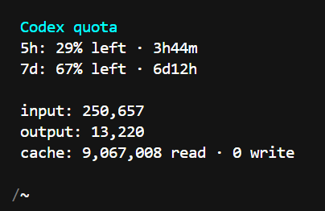

# opencode-codex-usage

[](https://www.npmjs.com/package/opencode-codex-usage)
[](LICENSE)

**A minimal OpenCode plugin for keeping Codex quota and token usage visible while you work.**

No dashboard tab. No extra model request. No noisy UI. Just a small server plugin and TUI plugin that show the information you need inside OpenCode.



## Why this plugin exists

Codex quota is easy to forget until a request fails. `opencode-codex-usage` puts the important numbers where the work already happens:

- quota windows and remaining percentage in the OpenCode TUI sidebar;
- input, output, and cache read/write usage for the current session;
- on-demand quota refreshes through `/codex-usage`;
- low-noise background notifications when a quota window reaches a configured threshold.

It is intentionally focused. It does not manage models, change provider routing, proxy prompts, or replace OpenCode authentication.

## Features

- **Dedicated quota endpoint** — reads `GET /backend-api/wham/usage` directly.
- **Zero model quota cost** — quota probes do not create assistant turns or send model requests.
- **Persistent TUI sidebar** — shows the primary and secondary quota windows alongside the current session.
- **Live token counters** — derives totals from OpenCode session messages and `step-finish` parts, then refreshes on message events.
- **Separate cache accounting** — displays cache read and cache write values independently.
- **Manual refresh command** — `/codex-usage` runs a local probe without an assistant turn.
- **Background polling** — starts on plugin load and repeats every two minutes by default.
- **Threshold-based toasts** — background notifications appear only when the configured severity threshold is reached and the state worsens.
- **Stale-data protection** — a failed probe keeps the last known good quota snapshot and marks it as stale instead of blanking the panel.
- **CLI output** — compact JSON for automation and a readable `--pretty` view for humans.
- **Transient retries** — network and timeout failures can be retried without retrying authentication or HTTP errors.
- **Paired OpenCode integration** — server-side background workers and TUI-side rendering are configured together.

## What the TUI shows

With the OpenCode sidebar open, the plugin renders a compact panel similar to:

```text
Codex quota
5h: 19% left · 1h0m
7d: 91% left · 7d0h
input: 21,879
output: 11
cache: 0 read · 0 write
```

The quota countdown is calculated from the absolute reset moment when the API provides one. Token counters are for the active OpenCode session and use the following data sources, in order:

1. `step-finish` parts attached to assistant messages;
2. assistant message token totals when step parts are unavailable;
3. the session-level token total as a fallback.

The panel updates when OpenCode emits `message.updated`, `message.part.updated`, or `message.removed`. It does not invent estimates when real usage is unavailable; missing values are shown as `-`.

### Opening the sidebar

OpenCode's default sidebar binding is the leader sequence `Ctrl+X`, then `B`. If your OpenCode keymap is customized, use its `sidebar_toggle` binding instead.

## Requirements

- OpenCode with server and TUI plugin support.
- A ChatGPT Plus or Pro plan connected through OpenCode's native authentication.
- Node.js for the npm/CLI installation paths.

Authentication stays with OpenCode. The plugin reads the credentials OpenCode already uses; it does not ask you to paste a token into plugin configuration.

## Installation

### Option A: install from npm

```bash
npm install -g opencode-codex-usage
opencode-codex-usage --install
```

The installer adds the package root to both the OpenCode server plugin configuration and the TUI plugin configuration. Restart OpenCode after installation.

### Option B: run with `npx`

```bash
npx opencode-codex-usage --install
```

Restart OpenCode after installation.

### Option C: use a local checkout

```bash
git clone https://github.com/aMoonshine/opencode-codex-usage.git
cd opencode-codex-usage
npm install
npm run build
npm link
opencode-codex-usage --install
```

Restart OpenCode after installation. The local checkout is useful when testing OpenCode API changes or developing the plugin.

### Manual plugin configuration

If you prefer to edit configuration yourself, add the **package root** to the `plugin` array in both OpenCode's server config and TUI config:

```json
{
  "plugin": ["/absolute/path/to/opencode-codex-usage"]
}
```

Do not point the plugin at `dist/index.js` or `dist/tui.js` manually. The package root exposes the paired server and TUI entrypoints correctly.

## Usage

### Refresh from inside OpenCode

```text
/codex-usage
```

This runs a local quota probe and shows the result as a toast. It does not invoke the assistant or consume model quota.

### Refresh from a shell

```bash
opencode-codex-usage
```

Useful CLI flags:

| Flag                  | Purpose                                                              |
| --------------------- | -------------------------------------------------------------------- |
| `--help`, `-h`        | Show CLI help.                                                       |
| `--json`, `--verbose` | Print a JSON snapshot to stdout on success.                          |
| `--pretty`            | Print a human-readable quota view with usage bars.                   |
| `--no-notify`         | Skip the refresh notification step.                                  |
| `--retry <0-2>`       | Override the transient retry count for this run.                     |
| `--install`           | Add the package root to OpenCode server and TUI plugin config.       |
| `--uninstall`         | Remove the package root from both plugin configs.                    |
| `--config <path>`     | Use a custom OpenCode config path with `--install` or `--uninstall`. |

Examples:

```bash
opencode-codex-usage --json
opencode-codex-usage --pretty
opencode-codex-usage --retry 2 --json
```

On failure, JSON error output is written to stderr and the CLI exits non-zero.

## Configuration

All settings are optional. Defaults are deliberately conservative.

### Poll interval

```bash
OPENCODE_CODEX_QUOTA_POLL_MS=120000
```

Default: `120000` ms (two minutes). Invalid or non-positive values use the default.

### Background toast threshold

```bash
OPENCODE_CODEX_QUOTA_TOAST_THRESHOLD=critical
```

Allowed values:

- `warn` — default; notify for warning, critical, or error states;
- `critical` — notify for critical or error states;
- `error` — notify only for errors;
- `always` — allow every background transition toast;
- `never` — keep the background worker and sidebar, but suppress background toasts.

Background notifications are still transition-aware: the plugin avoids repeating the same state and only announces a worsening state.

### Toast duration

```bash
OPENCODE_CODEX_QUOTA_TOAST_DURATION_MS=5000
```

Default: `5000` ms. Invalid or non-positive values use the default.

### Transient retry count

```bash
OPENCODE_CODEX_QUOTA_RETRY_COUNT=1
```

Allowed values are `0`, `1`, or `2`. Values above `2` are clamped to `2`; invalid values use the default. Authentication failures and HTTP errors are not retried.

### Manual refresh signal

```bash
OPENCODE_CODEX_USAGE_SIGNAL_PATH=/tmp/opencode-codex-usage.refresh
```

The server plugin watches this path for a refresh trigger. The default is a per-user temporary path.

### Authentication path override

OpenCode's native auth path is used by default. For advanced setups only:

```bash
OPENCODE_AUTH_PATH=/path/to/opencode/auth.json
```

Do not commit auth files or expose their contents. The plugin only needs the same authenticated account OpenCode already uses.

## Probe output

The CLI and internal probe produce one `ProbeSnapshot` JSON object per run. Common fields are:

| Field           | Meaning                                                                             |
| --------------- | ----------------------------------------------------------------------------------- |
| `status`        | Quota state such as `ok`, `warn`, `critical`, `error`, or `unknown`.                |
| `statusCode`    | HTTP status or a classified value such as `auth`, `network`, `timeout`, or `usage`. |
| `used`          | Primary and secondary percentage used.                                              |
| `reset`         | Human-readable reset duration for each window.                                      |
| `resetAtMs`     | Absolute reset moments used for live countdown rendering.                           |
| `windowMinutes` | API-reported window lengths when available.                                         |
| `plan`          | Plan type returned by the usage endpoint.                                           |
| `probeTokens`   | Always `0` for the WHAM quota endpoint because no model request is made.            |
| `error`         | Sanitized error detail when the probe fails.                                        |

Example:

```json
{
  "status": "warn",
  "statusCode": 200,
  "plan": "plus",
  "used": { "primary": 81, "secondary": 9 },
  "reset": { "primary": "1h0m", "secondary": "7d0h" },
  "resetAtMs": { "primary": 1767229200000, "secondary": 1767834000000 },
  "windowMinutes": { "primary": 300, "secondary": 10080 },
  "probeTokens": 0
}
```

## How it works

The package exposes two OpenCode integrations:

### Server plugin

- starts a background quota worker;
- calls `GET https://chatgpt.com/backend-api/wham/usage`;
- parses primary and secondary rate-limit windows;
- preserves the last successful snapshot when a later probe fails;
- emits threshold-based toasts;
- responds to manual refresh signals.

### TUI plugin

- registers `/codex-usage`;
- registers the quota sidebar panel;
- renders live quota countdowns;
- aggregates current-session input/output/reasoning/cache usage;
- refreshes token counters from OpenCode message events;
- cleans up polling timers and event subscriptions when the TUI disposes the plugin.

The plugin does not send prompts, create model responses, or proxy conversations. The only network request made for quota visibility is the authenticated usage request.

## Troubleshooting

### `provided authorization token is expired`

Reconnect the account through OpenCode:

```text
/connect
```

Choose the OpenAI/ChatGPT plan option, then restart OpenCode if necessary.

### The slash command is missing

1. Confirm the package root, not a compiled file, is present in the OpenCode plugin configuration.
2. Run the installer again:

   ```bash
   opencode-codex-usage --install
   ```

3. Fully restart OpenCode. Plugins are loaded during startup.

### The sidebar is empty

Open the OpenCode sidebar using the `sidebar_toggle` key binding. With the default keymap, press `Ctrl+X`, then `B`. Also make sure you are inside an active session rather than on the home screen.

### Counters show `-`

The plugin does not estimate usage. A dash means the current OpenCode session has not exposed a usable token record yet. Send a token-bearing response, keep the session open, and allow the message update event to refresh the panel.

### Quota shows stale data

The last known good snapshot is intentionally kept when the usage endpoint fails. Check authentication and network access; the next successful background or manual probe clears the stale state.

## Development

```bash
npm install
npm test
npm run lint
npm run build
npm run format:check
```

The test suite covers:

- WHAM usage parsing and window classification;
- reset timestamps and live countdown data;
- retry and error behavior;
- toast thresholds and polling;
- TUI sidebar rendering;
- message-derived and `step-finish` token aggregation;
- live render updates and plugin disposal.

Build the package before testing it as a local OpenCode plugin:

```bash
npm run build
opencode-codex-usage --install
```

## Uninstall

Remove the plugin configuration:

```bash
opencode-codex-usage --uninstall
```

Then remove the package if it was installed globally:

```bash
npm uninstall -g opencode-codex-usage
```

For a local npm link:

```bash
npm unlink -g opencode-codex-usage
```

Restart OpenCode after uninstalling.

## License

MIT. See [LICENSE](LICENSE).
